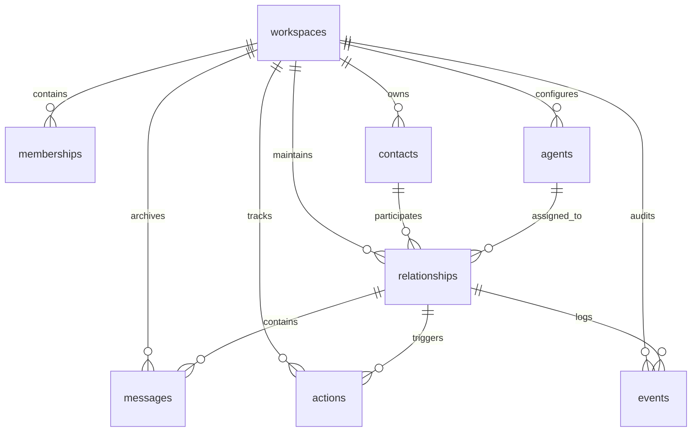

# Relationship Agent SaaS

An email-first, multi-tenant AI relationship manager that remembers conversations, proposes the next action, writes naturally, and acts only within configured permissions.

---

## Current Status: Phase 0 Completed & Verified

- **Next.js 14 App Router + TypeScript + Tailwind CSS**
- **Drizzle ORM Schema**: All 8 application tables (`workspaces`, `memberships`, `contacts`, `agents`, `relationships`, `messages`, `actions`, `events`)
- **Domain Contracts & Types**: Zod validation schemas for `AgentDecision`, `MessageDraft`, `ActionType`, and `RelationshipStage`
- **Provider Interfaces**: `LLMProvider`, `EmailSender`, `EmailInboundAdapter`
- **Mock Providers**: Deterministic, fixture-based mocks with zero external dependencies
- **Core Decision Engine**:
  - Ingests inbound emails / webhooks
  - Contextual relationship memory & verified facts
  - Zod-enforced decision schema
  - Server-side safety overrides (commercial/pricing requests automatically escalate to human approval)
  - Automatic suppression & opt-out handling
  - Automatic cancellation of pending generic follow-ups upon substantive reply
- **Action Service**:
  - Full action lifecycle (`PENDING`, `WAITING`, `AWAITING_APPROVAL`, `APPROVED`, `CANCELLED`)
  - Atomic approval verification
  - Draft editing with strict version bumping and previous approval invalidation
  - Multi-tenant workspace isolation enforcement
- **Vitest Test Suite**: 8 automated integration tests running with embedded PostgreSQL (`@electric-sql/pglite`), demonstrating the Phase 0 Exit Gate.

---

## Quick Start

### 1. Install Dependencies
```bash
pnpm install
```

### 2. Run Test Suite
```bash
pnpm test
```
Runs the 8 integration tests verifying the Phase 0 Exit Gate:
- `simulated inbound -> validated decision -> persisted next action`
- Suppressed contact protection (no outbound emails scheduled)
- Substantive inbound cancels pending follow-ups
- Pricing/commercial inquiry escalation to human approval
- Draft editing invalidates old approvals
- Opt-out suppresses contact and concludes relationship
- Safe handling of malformed LLM outputs
- Strict multi-tenant isolation

### 3. Run Dev Server
```bash
pnpm dev
```
Open [http://localhost:3000](http://localhost:3000) to open the interactive Phase 0 Development Harness:
- Trigger simulated inbound messages (or use presets: Info, Pricing, Opt-Out)
- Inspect real-time database state (Relationships, Actions Queue, Ingested Messages, Audit Events)
- Approve, edit, or reject actions awaiting human approval directly from the UI

---

## Technology Stack

| Concern | Choice |
|---|---|
| App & API | Next.js 14 App Router, TypeScript |
| UI | Tailwind CSS |
| Database | Supabase PostgreSQL / Drizzle ORM (PGlite in-process for tests & local dev) |
| Validation | Zod |
| LLM Provider Interface | OpenAI-ready adapter contract (Mock active in Phase 0) |
| Email Provider Interface | Resend-ready adapter contract (Mock active in Phase 0) |
| Testing | Vitest + PGlite |

---

## Core Domain Schema (8 Tables)



1. **`workspaces`**: Tenant root entity (`id`, `name`, `settings_json`, `created_at`, `updated_at`).
2. **`memberships`**: User roles & permissions (`workspace_id`, `user_id`, `role`, `permissions_json`).
3. **`contacts`**: Workspace-scoped contacts with suppression and provenance (`name`, `email_normalized`, `organisation`, `is_suppressed`, `suppression_reason`).
4. **`agents`**: Agent configuration, goals, instructions, voice profile, and permissions.
5. **`relationships`**: Stage (`NEW`, `OUTREACH`, `ENGAGED`, `OPTED_OUT`, etc.), summary, verified facts, open questions.
6. **`messages`**: Raw and parsed communications (`direction`, `channel`, `subject`, `body_text`, `status`, `metadata_json`).
7. **`actions`**: Persisted action queue (`type`, `status`, `scheduled_at`, `payload_json`, `approval_required`, `idempotency_key`).
8. **`events`**: Append-only audit history of all transitions and webhook events.
